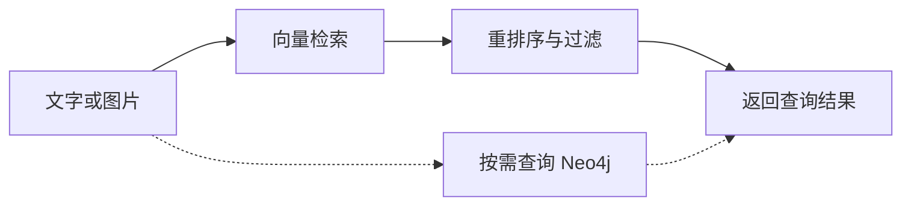

# RAG · 多模态文档问答

**把文档和图片变成可检索的资料库**

[功能概览](#功能概览) · [查询流程](#查询流程) · [代码索引](#代码索引)

## 功能概览

这个 Python 后端原型支持通过文字、图片或图文组合检索资料。返回结果带有来源和评分，便于回查原始内容。

| 能力 | 实现 |
| --- | --- |
| 资料入库 | 解析 TXT、Markdown、PDF、Word 和常见图片，支持 OCR、分块和 ZIP 批量导入 |
| 图文检索 | 使用 Chroma 存储向量，结合文本嵌入、CLIP 图像特征和 BERT 重排序 |
| 知识图谱 | 用 Neo4j 保存实体关系，查询时可以补充关联实体 |
| 资料维护 | 支持文档列表、更新、删除，以及系统状态和健康检查 |

## 查询流程

> [!NOTE]
> `/api/v1/query` 返回检索片段和关联实体。大模型生成、提示词和会话管理位于独立模块中。

## 代码索引

| 入口 | 对应内容 |
| --- | --- |
| [`main.py`](backend/app/main.py) | FastAPI 入口、健康检查和异常处理 |
| [`api.py`](backend/app/routers/api.py) | 资料管理、检索和系统状态接口 |
| [`document_processor.py`](backend/app/utils/document_processor.py) | 文件解析、OCR 和文本分块 |
| [`chroma_manager.py`](backend/app/utils/chroma_manager.py) | 向量索引、多模态检索和重排序 |
| [`kg_processor.py`](backend/app/utils/kg_processor.py) | 实体与关系抽取、图谱查询 |
| [`llm_manager.py`](backend/app/utils/llm_manager.py) | 调用 OpenAI API 或本地模型生成文本 |
